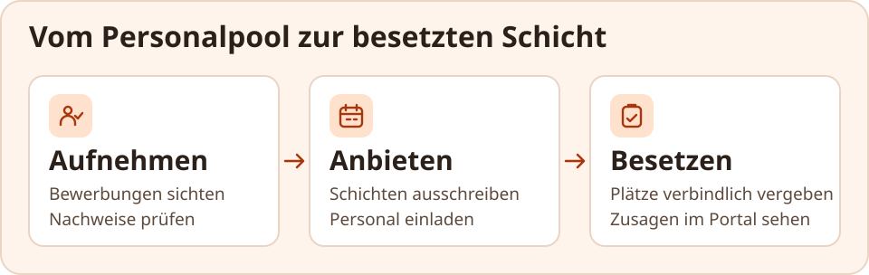
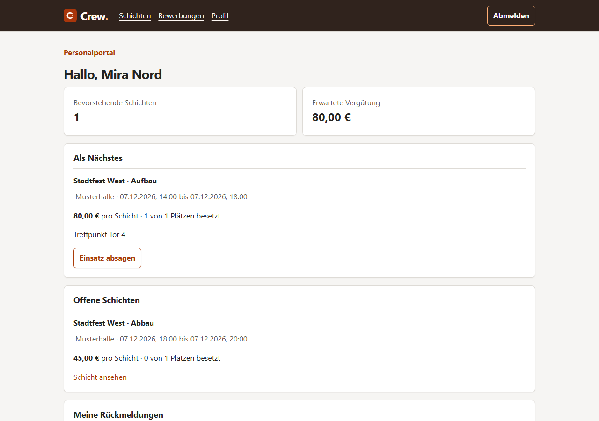

<picture>
  <source media="(prefers-color-scheme: dark)" srcset="docs/marke/crew-logo-dunkel.svg">
  
</picture>

# Schichten aus dem Personalpool besetzen

**Crew ist die selbst gehostete Personalplanung für Teams mit wechselnden Einsätzen.** Die Dispo nimmt Personal auf, prüft Qualifikationen und besetzt Schichten. Poolmitglieder melden Interesse und sehen Zusagen, Aufgaben und erwartete Vergütung im eigenen Portal. Crew lässt sich auf dem Smartphone und Desktop als Web-App installieren.

[](LICENSE)
[](docs/installation.md#docker-compose)

<picture>
  <source media="(prefers-color-scheme: dark)" srcset="docs/marke/crew-einsatzablauf-dunkel.svg">
  
</picture>

[Warum Crew?](#warum-crew) · [Einsatzablauf](#so-läuft-ein-einsatz) · [Funktionen](#funktionen) · [Desk und Haben](#desk-und-haben) · [Schnellstart](#schnellstart) · [FAQ](#häufige-fragen)

> [!NOTE]
> Crew 0.1.0.0 ist in Vorbereitung. Für einen Probelauf kannst du den aktuellen Quellstand lokal starten. [Schnellstart](#schnellstart) · [Crew Roadmap](https://github.com/orgs/Vemoro/projects/3/views/1)

## Warum Crew?

Bei wiederkehrenden Veranstaltungen ändern sich Ort, Uhrzeit und Besetzung. Die Dispo muss wissen, wer für eine Schicht infrage kommt, welche Nachweise fehlen und welche Zusagen bereits verbindlich sind. In Crew hängen diese Informationen am jeweiligen Poolprofil und an der Schicht. Frei gewordene Plätze können gezielt neu besetzt werden.

Das Personal hat eine eigene Übersicht für offene Angebote, Einladungen und bestätigte Einsätze. Fragen zur Schicht beantwortet es direkt bei der Bewerbung. Aufgaben wie ein nachzureichender PDF-Nachweis bleiben sichtbar, bis die Dispo sie geprüft hat.

## So läuft ein Einsatz

1. **Personal aufnehmen.** Bewerbende geben ihre Grunddaten und typische Verfügbarkeit an. Die Dispo entscheidet über die Aufnahme in den Pool und prüft Qualifikationen und PDF-Nachweise.
2. **Schichten vorbereiten.** Die Dispo erfasst Ort, Zeitraum, Plätze und Pauschale. Je Schicht kann sie Qualifikationen und Pflichtfragen festlegen. Beim Veröffentlichen bestimmt sie, ob die Schicht für den aktiven Pool oder nur für Eingeladene sichtbar ist.
3. **Verbindlich einteilen.** Poolmitglieder melden Interesse und beantworten die Fragen zur Schicht. Crew prüft bei der Vergabe verfügbare Plätze, Überschneidungen und die fälligen Qualifikationen.
4. **Änderungen koordinieren.** Die Dispo kann künftige Einsatzdetails korrigieren, einen Platz freigeben oder eine Schicht zurücknehmen. Wenn Personal eine Zusage absagt, kann die Dispo den Platz neu besetzen. Das Portal zeigt die aktualisierte erwartete Vergütung.

Beim fiktiven **Stadtfest West** schreibt die Dispo den Aufbau für den Personalpool aus. Zum Abbau lädt sie ausgewählte Personen ein. Mira beantwortet für den Aufbau die Frage nach dem Treffpunkt. Nach ihrer Einteilung stehen die bestätigte Schicht und 80 € erwartete Vergütung im Portal. [Durchgespielter Musterfall](scripts/check-browser.ts)

## Funktionen

| Bereich | Was du in Crew erledigst |
| --- | --- |
| **Bewerbung und Pool** | Grunddaten und typische Verfügbarkeit erfassen, Bewerbungen prüfen und Personen in den Pool aufnehmen. Zugänge bei Bedarf sperren und wieder freigeben. |
| **Qualifikationen und Aufgaben** | PDF-Nachweise einreichen und prüfen. Fehlende Nachweise anfordern, frühere Prüfungen zurücknehmen und fällige Aufgaben im Personalportal verfolgen. |
| **Einsätze und Schichten** | Mehrere Schichten pro Einsatz planen, Sichtbarkeit und Voraussetzungen festlegen, Fragen stellen und Plätze verbindlich besetzen. Künftige Details korrigieren und freigegebene Plätze neu besetzen. |
| **Personalportal und PWA** | Angebote, Einladungen, Zusagen und Aufgaben ansehen. Interesse melden, Nachweise hochladen und eigene Einteilungen absagen. Crew aus einem unterstützten Browser als App öffnen. |
| **Erwartete Vergütung** | Pauschalen je Schicht hinterlegen. Das Portal addiert die Beträge der bestätigten Schichten, die noch laufen oder bevorstehen. |
| **Betrieb und Personendaten** | Crew mit Docker Compose oder Bun betreiben, PostgreSQL sichern und wiederherstellen sowie einzelne Poolprofile exportieren und bereinigen. |

[App-Installation](docs/installation.md#crew-als-app-installieren) · [Kontozugang](docs/installation.md#zugang-sperren-oder-wiederherstellen) · [Personendaten](docs/personendaten.md)

### Blick ins Personalportal

<picture>
  <source media="(prefers-color-scheme: dark)" srcset="docs/ansichten/personalportal-dunkel.png">
  
</picture>

[Personalportal hell](docs/ansichten/personalportal-hell.png) · [Personalportal dunkel](docs/ansichten/personalportal-dunkel.png)

## Desk und Haben

| Werkzeug | Zusammenspiel mit Crew |
| --- | --- |
| **Desk** | Desk organisiert die Projektarbeit. In Crew kannst du bereits eine externe Referenz am Einsatz hinterlegen. Die automatische Übernahme von Einsätzen ist geplant. |
| **Haben** | Haben unterstützt die Abrechnung. Crew zeigt die erwartete Vergütung aus bestätigten Schichten an. Der Austausch von Abrechnungsdaten ist geplant. |
| **Eigenständiger Betrieb** | Crew verwaltet Pool, Qualifikationen, Schichten und Einteilungen auf dem eigenen Server. Einsatzreferenzen kannst du manuell erfassen. |

[Desk](https://github.com/Vemoro/desk) · [Haben](https://haben.app/) · [Produktumfang und Roadmap](docs/roadmap.md)

## Schnellstart

Du brauchst Docker Compose und für dieses Beispiel Bash und OpenSSL. Führe die Befehle im entpackten Quellstand oder Checkout aus. Für eine dauerhaft betriebene Instanz bewahrst du Datenbankpasswort und Sitzungsschlüssel in einer geschützten Umgebung auf. Wähle für das Dispo-Konto ein eigenes Passwort mit 12 bis 128 Zeichen ohne Zeilenumbruch.

```sh
export CREW_DB_PASSWORD="$(openssl rand -hex 32)"
export CREW_AUTH_SECRET="$(openssl rand -hex 32)"
docker compose up --build -d
docker compose exec crew bun run migrate
read -r -s -p 'Passwort für die Dispo eingeben: ' CREW_ADMIN_PASSWORD
printf '\n'
export CREW_ADMIN_PASSWORD
docker compose run --rm -e CREW_ADMIN_PASSWORD crew bun run admin dispo@example.test "Crew Dispo"
unset CREW_ADMIN_PASSWORD
```

1. Öffne `http://localhost:8080` und melde dich als Dispo an.
2. Registriere in einem zweiten Browserprofil eine fiktive Person und nimm sie in den Pool auf.
3. Lege einen Mustereinsatz und eine Schicht an. Veröffentliche sie für den Pool, melde als Personal Interesse und teile die Person als Dispo ein.

[Nativer Start mit Bun und PostgreSQL](docs/installation.md#nativer-betrieb-mit-bun) · [HTTPS und Reverse-Proxy](docs/installation.md#https-hinter-einem-reverse-proxy) · [SQLite-Migration](docs/migration.md) · [Sicherung und Wiederanlauf](docs/sicherung.md)

## Häufige Fragen

**Eignet sich Crew für mehrere Einsatzorte und kurzfristige Schichten?**

Ja. Du legst Ort und Hinweise am Einsatz sowie Beginn, Ende und Plätze je Schicht fest. Einzelne Angebote können für den ganzen Pool oder für ausgewählte Personen sichtbar sein.

**Kann ich die Selbstregistrierung pausieren?**

Ja. Betreiber können die Selbstregistrierung in der Konfiguration pausieren. Vorhandene Konten können sich weiterhin anmelden. [Registrierung konfigurieren](docs/installation.md#selbstregistrierung-pausieren)

**Kann ich Crew als App nutzen?**

Ja. Öffne deine Instanz über HTTPS in einem unterstützten Browser und installiere die Web-App. Schichten, Nachweise, Anmeldung und Formularübermittlungen brauchen eine Verbindung zur Instanz. Beim nächsten Öffnen ohne Verbindung erscheint ein Hinweis, wenn Crew zuvor online geöffnet wurde und der Service Worker aktiv ist. [Installationswege für Desktop und Smartphone](docs/installation.md#crew-als-app-installieren)

**Wie berechnet Crew die erwartete Vergütung?**

Crew addiert die hinterlegten Pauschalen der bestätigten und noch nicht beendeten Schichten. Wenn ein Platz zurückgegeben wird oder die Dispo ihn freigibt, passt Crew die Summe an. Abrechnung und Lohnlauf erfolgen in deinem Abrechnungssystem.

## Mitwirken

Crew steht unter der AGPL-3.0-only. Fehlerberichte, Vorschläge und Beiträge sind willkommen. Auf der Crew Roadmap siehst du den Stand geplanter Aufgaben und der nächsten Auslieferung. [Issueboard](https://github.com/orgs/Vemoro/projects/3/views/1) · [Fehler oder Vorschlag melden](https://github.com/Vemoro/crew/issues/new/choose) · [Mitwirken](CONTRIBUTING.md) · [Entwicklungsregeln](docs/entwicklung.md) · [Sicherheitsmeldungen](SECURITY.md) · [Versionshinweise](CHANGELOG.md) · [Lizenz](LICENSE)
